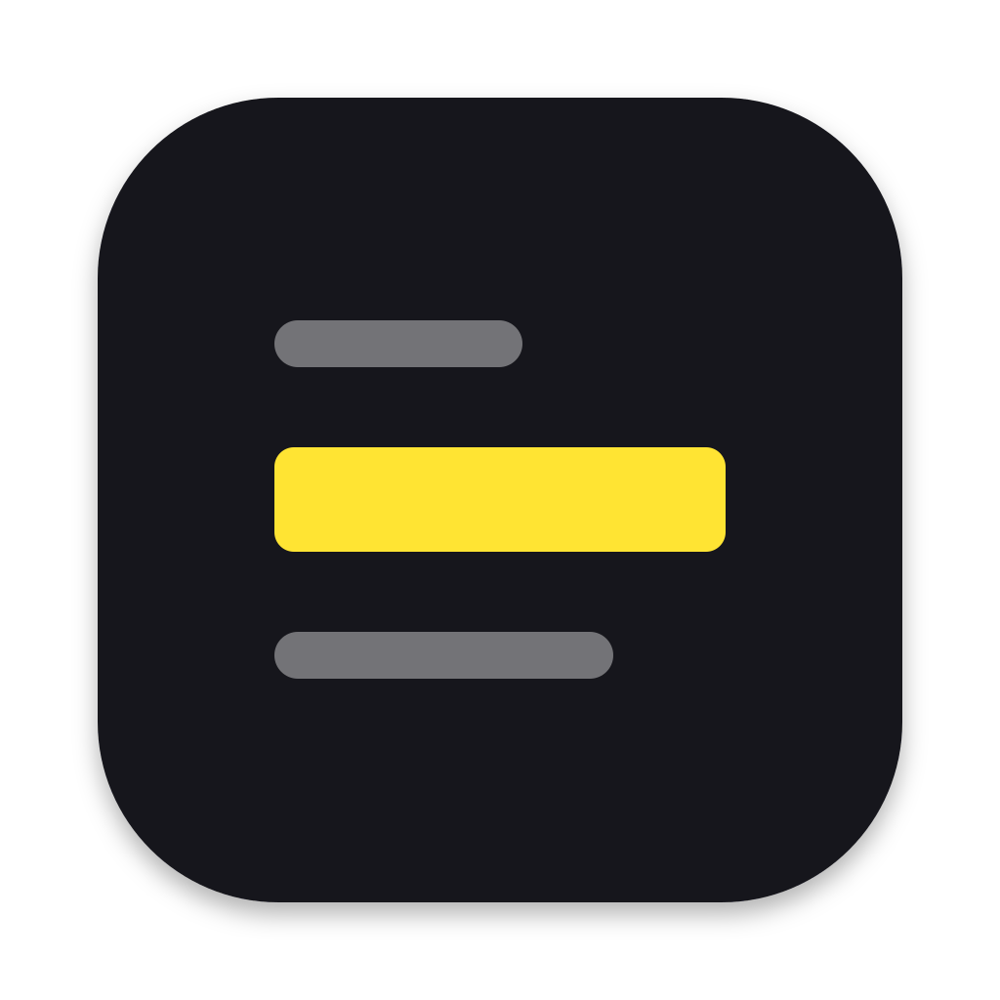
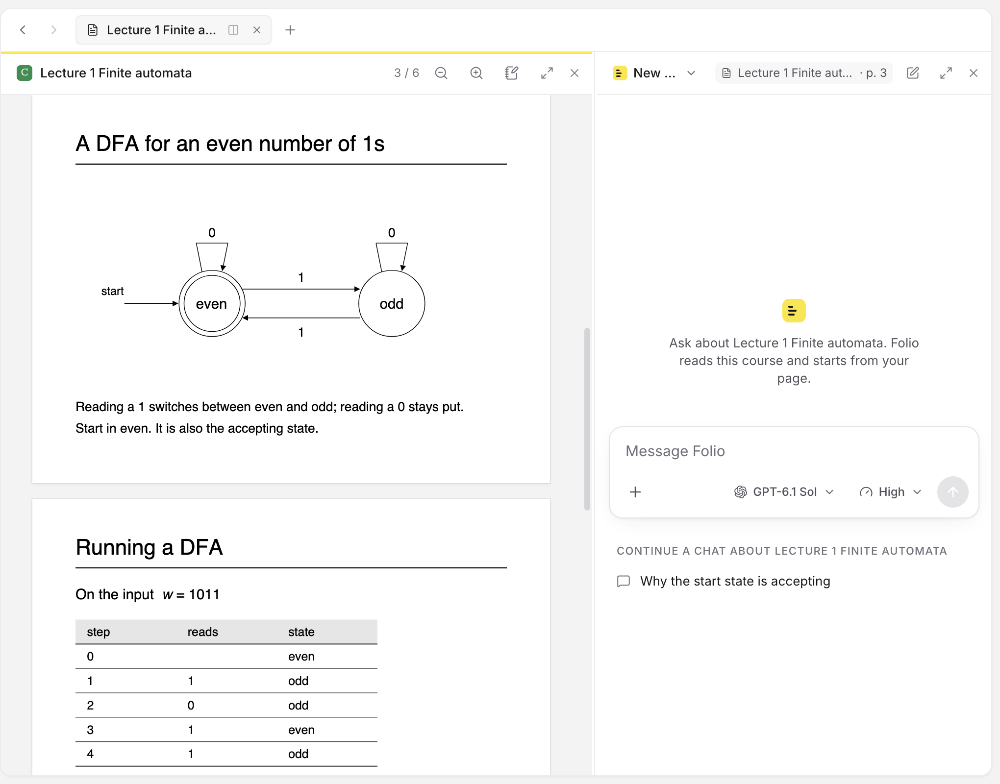
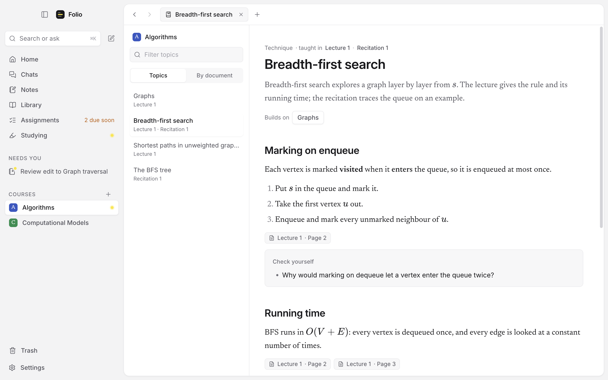
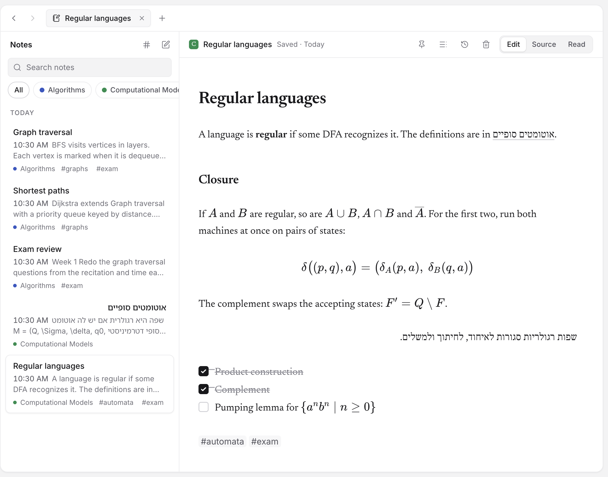
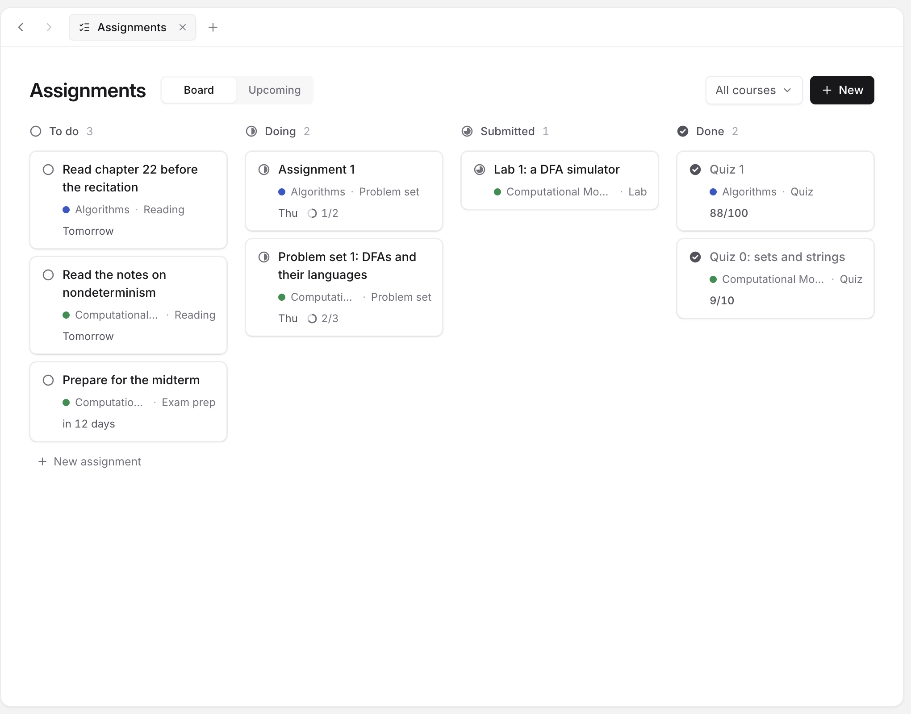
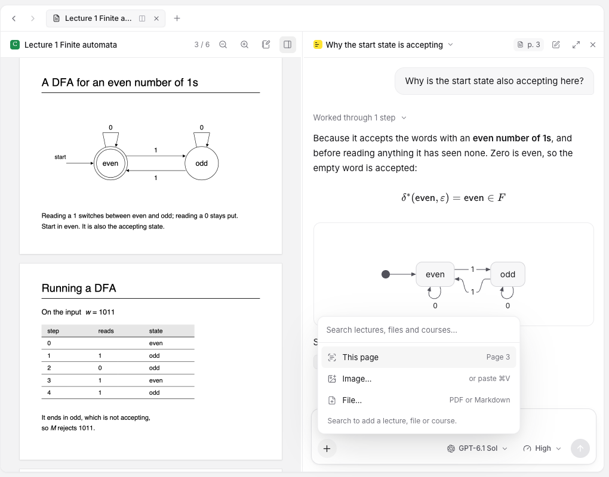

<p align="center">
  
</p>

<h1 align="center">Folio</h1>

<p align="center">
  A local-first study workspace for Mac and Windows, with a tutor that reads your course with you.
</p>

<p align="center">
  <a href="https://github.com/GuyAzene/folio/actions/workflows/ci.yml"></a>
  <a href="https://github.com/GuyAzene/folio/releases/latest"></a>
  <a href="LICENSE"></a>
  
  
</p>

<p align="center">
  <a href="#try-folio"><b>Download for Mac or Windows</b></a> ·
  <a href="#what-it-does">What it does</a> ·
  <a href="https://github.com/users/GuyAzene/projects/1">Roadmap</a> ·
  <a href="CONTRIBUTING.md">Contributing</a>
</p>

<picture>
  <source media="(prefers-color-scheme: dark)" srcset="docs/images/tutor-dark.webp">
  
</picture>

Folio keeps a course in one place on your computer: lecture slides, recitations, assignments and
your own notes. Its tutor answers from your course's own pages and cites them. It can study your
lectures into notes you can browse, and it never changes your files.

> [!NOTE]
> Folio is early and in active development. It is tested on macOS and Windows on every change;
> Windows builds come from the nightly build for now. The tutor runs on your ChatGPT plan or on
> your own API keys.

## What it does

- **Courses and a reader.** Add a course from its syllabus, from a folder of PDFs, or empty.
  Files are copied in and never modified. The reader shows a lecture with the tutor beside it,
  and a tab can hold up to three panes side by side: a lecture, its homework, a note, a chat. A
  chat reopens beside the lecture it was about.
- **A tutor grounded in your course.** A course chat reads only that course and cites the pages
  it used; a chat from Home works out which course you mean. The tutor sees each page as an
  image, so diagrams and drawn automata count.
- **Add context on purpose.** The **+** in the composer adds the page you're on, an image (or
  paste one), another lecture or another course. Nothing is added unless you add it, and the
  model can never widen what a chat reads.
- **Ask in your own words.** "Quiz me on this lecture", "get me ready for lecture 4", "where is
  this used later?" or "one step at a time": the tutor recognizes the request; there are no
  modes to pick.
- **Your routines.** Write how you like to study as a routine (an Agent Skills `SKILL.md`), or
  add a folder of your own routines and turn on the ones you want. The tutor follows one when it
  fits, or start it yourself with `/name`. Folio reads their instructions and never runs their
  scripts.
- **Your services.** Connect MCP servers, such as one for your university's Moodle: the tutor can
  use their tools and you can start their prompts with `/`. Folio asks before each call, showing
  exactly what it will send, until you allow a tool.
- **Diagrams, drawings and demos.** The tutor draws Mermaid diagrams (flowcharts, automata,
  sequences) right in the reply, and shows drawings or interactive demos you can step through.
  Demos run sealed off from Folio and the network.
- **Study notes.** Folio studies every lecture and recitation you add, page by page, into notes
  by topic that each cite the slides they came from, and folds later ones into the same topics.
- **Your own notes.** One notebook for every course, with `#tags`, search, ⌘O, links between
  notes and the notes that mention each one. Markdown with live preview, math, tables, diagrams,
  and Hebrew and English lines side by side. Write beside a lecture with links back to its pages,
  save a tutor's answer to a note, or ask the tutor to write, change or rename one; every change
  can be undone. Notes can hold colored blocks, centered titles and figures cropped from a PDF,
  and the tutor looks at how a note it wrote is drawn, in both views, and fixes what's off.
- **Assignments.** A board of what you have to hand in, read or prepare, from To do to Done, with
  what you handed in, the grade and the feedback kept with each one.
- **Nothing lost.** Removed files, notes, chats, assignments and courses wait 30 days in Folio's
  Trash.

<table>
  <tr>
    <td width="50%"><b>Study notes</b>, by topic, each citing its slides<br><br>
<picture>
  <source media="(prefers-color-scheme: dark)" srcset="docs/images/study-notes-dark.png">
  
</picture></td>
    <td width="50%"><b>Your notebook</b>, with math, tasks and Hebrew beside English<br><br>
<picture>
  <source media="(prefers-color-scheme: dark)" srcset="docs/images/notebook-dark.png">
  
</picture></td>
  </tr>
  <tr>
    <td width="50%"><b>Assignments</b>, from To do to Done<br><br>
<picture>
  <source media="(prefers-color-scheme: dark)" srcset="docs/images/board-dark.png">
  
</picture></td>
    <td width="50%"><b>Add context with +</b>: the page you're on, or any lecture<br><br>
<picture>
  <source media="(prefers-color-scheme: dark)" srcset="docs/images/add-context-dark.png">
  
</picture></td>
  </tr>
</table>

## Try Folio

Folio needs a ChatGPT plan or an API key.

**On a Mac** (Apple silicon): download the disk image from the
**[latest release](https://github.com/GuyAzene/folio/releases/latest)**, open it and drag Folio to
Applications. Each release lists what changed and how to check that the download is the one this
repository built. For the newest Folio between releases, the
[nightly build](https://github.com/GuyAzene/folio/releases/tag/nightly) has
**[Folio-arm64.dmg](https://github.com/GuyAzene/folio/releases/download/nightly/Folio-arm64.dmg)**.

Folio is signed with a Developer ID and notarized by Apple, so it opens like any app downloaded
from the internet. Releases up to 0.2.1 aren't, and the first time you open one, macOS says it
could not verify it. Open **System Settings → Privacy & Security**, scroll down to the line about
Folio and choose **Open Anyway**.

**On Windows** (64-bit Windows 10 or 11): Windows builds are nightly for now. Download
**[Folio-x64-setup.exe](https://github.com/GuyAzene/folio/releases/download/nightly/Folio-x64-setup.exe)**
from the [nightly build](https://github.com/GuyAzene/folio/releases/tag/nightly) and run it. It
installs Folio for you alone, with no administrator, adds it to the Start menu and opens it.
Folio is not signed with a code-signing certificate, so Windows says it protected your PC: choose
**More info**, then **Run anyway**.

The nightly build is rebuilt after every change to `main`, so it is the newest Folio and may be
rougher than a release. When a newer release is out, a line in Folio's sidebar says so. On a Mac,
from 0.2.3 on, clicking it downloads the update, and restarting installs it. On Windows the line
links to the release's page.

## Getting started

You need macOS or Windows, the [Vite+](https://viteplus.dev/guide) CLI (`vp`) and a ChatGPT plan
or an API key. Folio pins Node 24.22.1 in `.node-version`; `vp` installs and uses it.

```sh
vp install --frozen-lockfile
vp node node_modules/electron/install.js   # once: fetch Electron's binary
vp run desktop                             # the app, with hot reload for the interface
```

To run the production build instead, use `vp run desktop:build`, then `vp run desktop:start`.

### Installing Folio as an app

On a Mac:

```sh
vp run desktop:install
```

This builds `Folio.app` from the checkout as it is and puts it in Applications, in place of the
copy there. Run it again whenever you want the newest Folio: a Folio that is open quits first and
opens again once the new one is in place. An app built on your Mac opens without macOS's warning
about unverified apps, since it was never downloaded. The build runs in a folder of its own, so a
Folio running from the checkout keeps going. The app keeps your data in `~/.folio`, like the
development build; quit a development build before opening the app.

`vp run desktop:package` builds the app and a disk image for Apple silicon,
`release/Folio-<version>-arm64.dmg`, without installing anything.

The app is signed ad-hoc, so it runs on the Mac that built it, and another Mac may refuse to open
it. Releases and the nightly are signed with a Developer ID and notarized in CI;
`scripts/package.ts` names the environment variables that do the same on your Mac.

On Windows, `vp run desktop:package` builds `release/win-unpacked/Folio.exe` and its installer,
`release/Folio-<version>-x64-setup.exe`; run the installer to put Folio in your programs. Quit
Folio before building again, since Windows won't replace the files of a program that is running.

To connect, choose **Connect ChatGPT** in the composer or in Settings (⌘, or Ctrl+,). Your
browser opens ChatGPT's sign-in. Folio registers with your ChatGPT account once; signing out and in again reuses
that registration, so ChatGPT's settings list one Folio. To use your own API key for OpenAI, Anthropic, Google Gemini or OpenRouter,
add it in **Settings → Connections**: Folio checks it with the provider before keeping it, and
each provider bills its key for what Folio asks. ChatGPT is the only plan Folio can sign in to.
Folio never reads a key from the environment or another app's saved accounts.

Which model does what is yours to choose, in **Settings → Models** or in `~/.folio/config.json`:
the tutor for new chats, web search, each step of studying (planner, reader, close-up, writer,
checker, topics) and reading a syllabus. Reading slides needs a model that sees images; writing
the notes can use one that reads text only. OpenRouter's models are picked in the same place and
appear in the composer by lab; Folio checks pi.dev every few hours for models OpenRouter added
since Folio's Pi release. Leave the file alone and everything runs on ChatGPT, as before.

```json
{
  "version": 1,
  "studying": {
    "reader": "chatgpt/gpt-6.1-sol",
    "writer": "openrouter/deepseek/deepseek-v4-pro"
  }
}
```

### Keyboard

On Windows, Ctrl stands in for ⌘ and Alt for ⌥, and Folio's own labels say so.

| Keys | Action |
| --- | --- |
| Enter / Shift+Enter | Send / new line |
| Esc | Stop a reply |
| ⌘K | Search everything |
| ⌘N / ⌘T / ⌘W | New chat / new tab / close the pane, or the tab |
| ⌥-click | Open beside, in a new pane |
| ⌘1–9, ⌘[ ⌘] | Switch tabs, go back and forward |
| ⌘J | Show or hide the tutor beside a document |
| ⌘\\ | Show or hide the sidebar |
| ⌘E | Switch a note between source and reading view |

## Your data

Everything Folio keeps stays in `~/.folio/` (on Windows, `.folio` in your user folder; or the
folder `FOLIO_HOME` points to), readable only by you: your courses and their read-only
originals, your notes, your chats, study notes and open tabs. Only what a question needs goes to
the service its model runs on: your message, the pages and images the tutor reads, and what you
added. Signing out, or removing a key, removes it
and keeps everything else. API keys stay in `keys.json`, apart from `config.json`, which never
holds one. MCP servers you connect get only what the tutor writes into a call, which you see
before you allow it; their settings and keys stay in `mcp.json`. Once a day Folio asks GitHub
whether a newer release is out. The request carries nothing about you, Folio downloads the
release only when you click to update, and **Settings → General** turns the check off. See [docs/architecture.md](docs/architecture.md#on-disk) for the layout.

## Roadmap

What's planned is on the [Folio roadmap](https://github.com/users/GuyAzene/projects/1), and each
upcoming version has a [milestone](https://github.com/GuyAzene/folio/milestones). Bug reports and
ideas are welcome as [issues](https://github.com/GuyAzene/folio/issues/new/choose).

## Built with

- [Electron](https://www.electronjs.org/) for the desktop app on macOS and Windows, with the
  interface in [Svelte 5](https://svelte.dev/), [Tailwind CSS](https://tailwindcss.com/) and
  [Bits UI](https://bits-ui.com/)
- [Pi](https://pi.dev/) for the tutor's connections to models and its agent loop
- [pdf.js](https://mozilla.github.io/pdf.js/) for reading, [CodeMirror](https://codemirror.net/)
  for notes and [KaTeX](https://katex.org/) for math
- [Vite+](https://viteplus.dev/) for building, checking and testing

## Development

```sh
vp check            # formatting, lint and types
vp run check:ui     # Svelte checks for the renderer
vp test             # deterministic tests: no network, no real accounts
vp run test:electron # Folio in a real window: security rules, diagrams, demos
vp run study:report # where each study's time went, from jobs.sqlite (read-only; --job, --since)
FOLIO_BENCH=1 vp run study:bench # study synthetic lectures with ChatGPT and score the notes
vp run desktop:package # Folio.app and its disk image, or Folio.exe and its installer, in release/
vp run desktop:install # on a Mac, the same, then Folio.app into /Applications
vp build && vp pack # renderer, CLI and Electron bundles
vp dev              # the interface alone, in a browser, with synthetic data
vp run screenshots  # the README's pictures that changed, from that preview, into a temporary folder
```

The benchmark spends your ChatGPT plan, so it runs only with `FOLIO_BENCH=1` and never in `vp
test`; `--fake` runs it offline, `--inject-omission k` takes k planted sections out of each first
draft, and `--compare a b` sets two saved runs (`.bench/<commit>.json`) side by side.

`vp dev` serves the interface against a development-only preview bridge with synthetic courses,
which is handy for checking layouts. A terminal client with a small synthetic demo course also
ships: run `vp run chat`, and `vp run chat --help` for its options.

`FOLIO_E2E_APP=release/mac-arm64/Folio.app vp run test:electron` runs the real-window checks
against the packaged app instead of a fresh build; on Windows, name
`release/win-unpacked/Folio.exe`. On a Mac with a Developer ID, name a signed Folio.app there and,
in `FOLIO_E2E_UPDATE`, the `release/` folder of a newer signed build, and
`tests/electron/self-update.e2e.ts` updates the one to the other.

Read [AGENTS.md](AGENTS.md) for how changes are made and checked, and
[docs/architecture.md](docs/architecture.md) for how the pieces fit together.

## Project layout

```text
app/        the interface (Svelte 5)
src/        the main process: chats, library, studying, study notes, storage
tests/      test suites and synthetic fixtures
scripts/    development and packaging scripts
resources/  the app icon
docs/       architecture and images
.github/    continuous integration
```

## Contributing

Bug reports and ideas are welcome as [issues](https://github.com/GuyAzene/folio/issues/new/choose).
Folio isn't accepting outside code yet. [CONTRIBUTING.md](CONTRIBUTING.md) explains how changes
are made and checked, and [SECURITY.md](SECURITY.md) how to report a security problem privately.
Everyone taking part follows the [code of conduct](CODE_OF_CONDUCT.md).

## License

[MIT](LICENSE).
