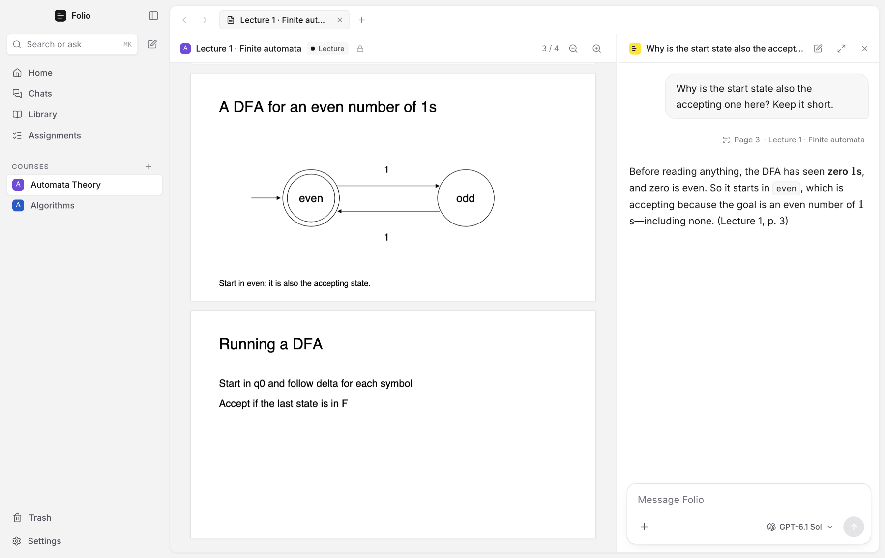
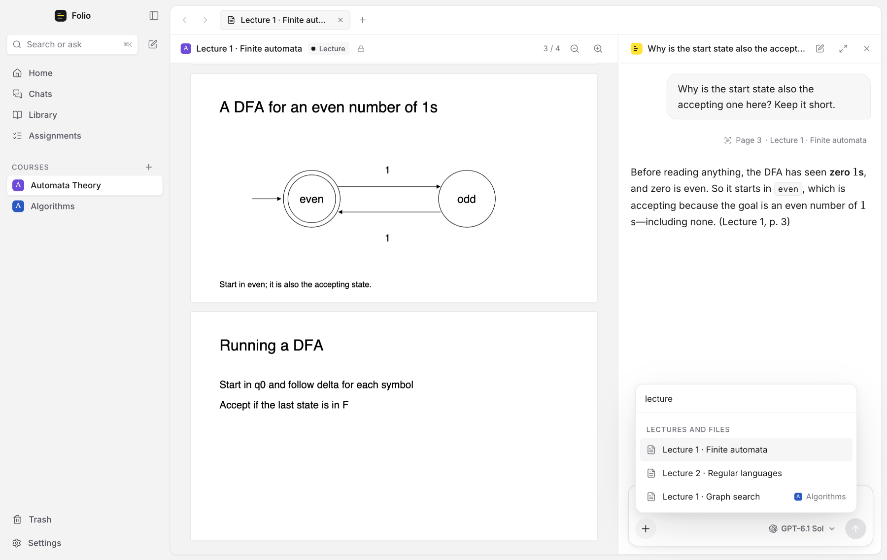
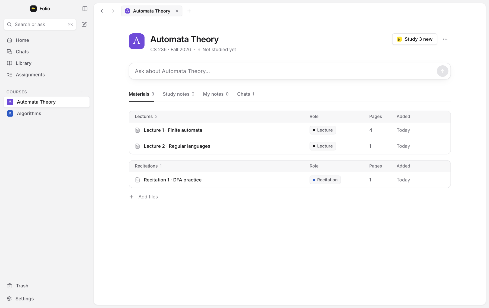

# Folio

A local-first desktop study workspace with a tutor that reads your course with you.



Folio keeps a course in one place on your computer: lecture slides, recitations, assignments and
your own notes. Its tutor answers from your course's own pages and cites them. It can study your
lectures into notes you can browse, and it never changes your files.

> [!NOTE]
> Folio is early and in active development. It is built and tested on macOS, and the tutor runs
> on your ChatGPT plan.

## What it does

- **Courses and a reader.** Add a course from its syllabus, from a folder of PDFs, or empty.
  Files are copied in and never modified. The reader shows a lecture with the tutor docked beside
  it.
- **A tutor grounded in your course.** A course chat reads only that course and cites the pages
  it used; a chat from Home works out which course you mean. The tutor sees each page as an
  image, so diagrams and drawn automata count.
- **Add context on purpose.** The **+** in the composer adds the page you're on, an image (or
  paste one), another lecture or another course. Nothing is added unless you add it, and the
  model can never widen what a chat reads.
- **Ask in your own words.** "Quiz me on this lecture", "get me ready for lecture 4", "where is
  this used later?" or "one step at a time": the tutor recognizes the request; there are no
  modes to pick.
- **Diagrams, drawings and demos.** The tutor draws Mermaid diagrams (flowcharts, automata,
  sequences) right in the reply, and shows drawings or interactive demos you can step through.
  Demos run sealed off from Folio and the network.
- **Study notes.** Folio studies every lecture and recitation you add, page by page, into notes
  by topic that each cite the slides they came from, and folds later ones into the same topics.
- **Your own notes.** One notebook for every course, with `#tags`, search, ⌘O, links between
  notes and the notes that mention each one. Markdown with live preview, math, tables, diagrams,
  and Hebrew and English lines side by side. Write beside a lecture with links back to its pages,
  save a tutor's answer to a note, or ask the tutor to write, change or rename one; every change
  can be undone.
- **Assignments.** A board of what you have to hand in, read or prepare, from To do to Done, with
  what you handed in, the grade and the feedback kept with each one.
- **Nothing lost.** Removed files, notes, chats, assignments and courses wait 30 days in Folio's
  Trash.

| Add context with + | A course |
| --- | --- |
|  |  |

## Try Folio

Download **[Folio-arm64.dmg](https://github.com/GuyAzene/folio/releases/download/nightly/Folio-arm64.dmg)**
from the [nightly build](https://github.com/GuyAzene/folio/releases/tag/nightly), open it and
drag Folio to Applications. It needs a Mac with Apple silicon and a ChatGPT plan, and is rebuilt
after every change, so the link always gives the newest Folio.

Folio is not signed with an Apple Developer ID, so the first time you open it macOS says it could
not verify it. Open **System Settings → Privacy & Security**, scroll down to the line about Folio
and choose **Open Anyway**. A newer download may ask again.

## Getting started

You need macOS, the [Vite+](https://viteplus.dev/guide) CLI (`vp`) and a ChatGPT plan. Folio
pins Node 24.22.1 in `.node-version`; `vp` installs and uses it.

```sh
vp install --frozen-lockfile
vp node node_modules/electron/install.js   # once: fetch Electron's binary
vp run desktop                             # the app, with hot reload for the interface
```

To run the production build instead, use `vp run desktop:build`, then `vp run desktop:start`.

### Installing Folio as an app

```sh
vp run desktop:install
```

This builds `Folio.app` from the checkout as it is and puts it in Applications, in place of the
copy there. Run it again whenever you want the newest Folio: a Folio that is open quits first and
opens again once the new one is in place. An app built on your Mac opens without macOS's warning
about unverified apps, since it was never downloaded. The build runs in a folder of its own, so a
Folio running from the checkout keeps going. The app keeps your data in `~/.folio`, like the
development build; quit a development build before opening the app.

`vp run desktop:package` builds the app and a disk image for Apple silicon,
`release/Folio-<version>-arm64.dmg`, without installing anything.

The app is signed ad-hoc, so it runs on the Mac that built it. Another Mac may refuse to open it
until builds are signed with a Developer ID and notarized; `scripts/package.ts` names the
environment variables that turn both on.

To connect, choose **Connect ChatGPT** in the composer or in Settings (⌘,). Your browser opens
ChatGPT's sign-in. Folio never uses an `OPENAI_API_KEY` or another app's saved accounts.

### Keyboard

| Keys | Action |
| --- | --- |
| Enter / Shift+Enter | Send / new line |
| Esc | Stop a reply |
| ⌘K | Search everything |
| ⌘N / ⌘T / ⌘W | New chat / new tab / close tab |
| ⌘1–9, ⌘[ ⌘] | Switch tabs, go back and forward |
| ⌘J | Show or hide the tutor beside a document |
| ⌘\\ | Show or hide the sidebar |
| ⌘E | Switch a note between source and reading view |

## Your data

Everything Folio keeps stays in `~/.folio/` (or the folder `FOLIO_HOME` points to), readable
only by you: your courses and their read-only originals, your notes, your chats, study notes and
open tabs. Only what a question needs goes to ChatGPT: your message, the pages and images the
tutor reads, and what you added. Signing out removes the saved sign-in and keeps everything
else. See [docs/architecture.md](docs/architecture.md#on-disk) for the layout.

## Development

```sh
vp check            # formatting, lint and types
vp run check:ui     # Svelte checks for the renderer
vp test             # deterministic tests: no network, no real accounts
vp run test:electron # Folio in a real window: security rules, diagrams, demos
vp run desktop:package # Folio.app and its disk image, in release/
vp run desktop:install # the same, then Folio.app into /Applications
vp build && vp pack # renderer, CLI and Electron bundles
vp dev              # the interface alone, in a browser, with synthetic data
```

`vp dev` serves the interface against a development-only preview bridge with synthetic courses,
which is handy for checking layouts. A terminal client with a small synthetic demo course also
ships: run `vp run chat`, and `vp run chat --help` for its options.

`FOLIO_E2E_APP=release/mac-arm64/Folio.app vp run test:electron` runs the real-window checks
against the packaged app instead of a fresh build.

Read [AGENTS.md](AGENTS.md) for how changes are made and checked, and
[docs/architecture.md](docs/architecture.md) for how the pieces fit together.

## Project layout

```text
app/        the interface (Svelte 5)
src/        the main process: chats, library, studying, study notes, storage
tests/      test suites and synthetic fixtures
scripts/    development and packaging scripts
resources/  the app icon
docs/       architecture and images
.github/    continuous integration
```

## Contributing

Folio isn't accepting outside contributions yet. To report a security problem, see
[SECURITY.md](SECURITY.md).

## License

All rights reserved. No license has been chosen yet.
